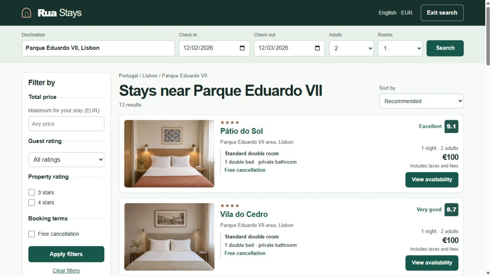

# Rua Stays · 里斯本酒店搜索实验

Rua Stays 是一个模拟酒店预订网站。它用一个 2×2 随机实验研究，第二次展示高质量或低质量酒店时，消费者是否继续浏览、回看、预订，或主动结束搜索。



## 本机运行

需要 Node.js 24 或更新版本。

```sh
npm run build
npm start
```

| 入口 | 用途 |
| --- | --- |
| [被试入口](http://127.0.0.1:4329/) | 同意后进入搜索结果，由服务端随机分组 |
| [研究后台](http://127.0.0.1:4329/research) | 指定四种条件进行预览，查询会话与排名历史，下载 CSV |

Windows 下也可以双击 `Start_Rua_Stays.cmd`。本地 SQLite 保存至 `work/rua-v3.sqlite`。在后台启动的会话标记为 `preview`。

## 实验设计

| 条件 | 第 1 位 | 第 7 位 |
| --- | --- | --- |
| 高质量 × 重复 | 高质量焦点 H | 同一家 H |
| 高质量 × 新酒店 | 高质量焦点 H | 全新中档酒店 M6 |
| 低质量 × 重复 | 低质量焦点 L | 同一家 L |
| 低质量 × 新酒店 | 低质量焦点 L | 同一家全新中档酒店 M6 |

第 2–6 位固定为 M1–M5，第 8–13 位固定为 M7–M12。搜索列表连续滚动。H 或 L 重复时，两个展示位置对应同一酒店、不同展示实例。价格、房型和取消条件统一。酒店评分来源与第 7 位的匹配依据见[刺激表](docs/STIMULI.md)。

主要比较分别在高焦点组内、低焦点组内估计重复展示与展示中档新酒店之差。两项组内效应之差是交互效应。

## 研究后台

后台按会话展示曝光、点击来源、实际与默认排名、预订和退出。可下载会话、列表排名、行为事件和刺激映射，前三表用 `session_id` 关联。数据库保存已同意会话及预览数据。公开仓库提供源码、规范和模拟界面截图。[查看数据字典](docs/EVENTS.md)

## 验收与部署

- `npm test` 验证四组排名、会话持久化、变更排名、行为去重、预订、退出和研究后台权限。
- [查看桌面和手机流程截图](docs/QA.md)
- [查看 HTTPS 部署说明](docs/DEPLOYMENT.md)

预订为模拟流程，住客信息由网站预填测试值。

